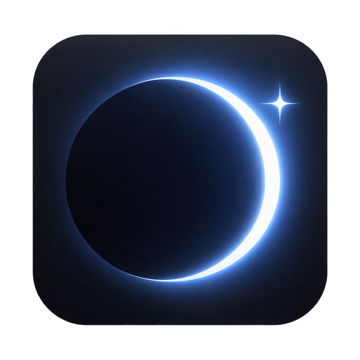

<h1 align="center">EclipseAssistant</h1>

A focused desktop workspace for contextual AI.

<a href="https://github.com/EclipseReign/eclipse_assistant/releases/latest">Download for Windows</a> · <a href="https://github.com/EclipseReign/eclipse_assistant/releases">Release notes</a> · <a href="mailto:saint.john.bobby@gmail.com">Support</a>

## Less switching. More context.

Bring selected screenshots, documents and conversation context into one minimal desktop workspace. Use Gemini and GPT, keep your conversation together, and choose a faster response or a deeper analysis when the task needs it.

- **Context that stays together.** Questions, selected files and ordered screenshot packs in one session.
- **Live conversation support.** Separate microphone and speaker context, with configurable shortcuts.
- **Your connection choice.** An Eclipse account with an active plan or personal grant, or your own provider API keys without an Eclipse subscription. Provider API charges still apply.
- **A quiet interface.** Adjustable transparency and distinct Hide and Minimize controls.
- **Updates in place.** Installed Windows builds notify you when an update is available; restart when your session is finished.

## Get started

1. Download the installer from [Releases](https://github.com/EclipseReign/eclipse_assistant/releases/latest).
2. Install EclipseAssistant, then sign in and confirm your email, or choose **Advanced / own keys**.
3. Choose your model and audio mode, then press **Start Session**. Only capture or share material you are authorized to use.

Current installers target Windows x64. Use your organization's meeting, privacy and assessment rules; this software does not grant permission to record another person or bypass an assessment policy.

## Privacy and support

Selected context is processed by the configured AI provider. Managed-account requests pass through EclipseAssistant's service; own-key connections can use an owned fallback relay if the primary transport is unavailable. Provider eligibility, rate limits and data policies still apply. No network route is guaranteed to work on every network.

Screen-capture protection is best-effort and depends on the operating system and capture method. It is **not** a guarantee of invisibility to every recording, remote-access tool, mirrored display or administrator. Review your sharing setup before use.

Send feedback directly from the app, or email **saint.john.bobby@gmail.com**. Never include API keys, passwords, recordings or identity documents in public issues.

## Project and license

Maintained by **EclipseReign**. Inspired by and derived from [cheating daddy](https://github.com/sohzm/cheating-daddy) by sohzm and its contributors; EclipseAssistant is an independently modified distribution, not an official upstream release.

The desktop application remains licensed under **GNU GPL v3**. The corresponding source archive for each release is available with that release. This showcase has its own small public history; ongoing development happens in a separate repository. Keeping development private does not restrict recipients' rights under GPL. See [NOTICE](NOTICE.md) and [LICENSE](LICENSE).
