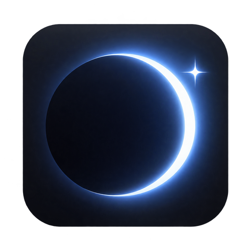

<h1 align="center">EclipseAssistant</h1>

A focused desktop workspace for contextual AI.

<a href="https://eclipseassistant-site.feedfix-cloudflare.workers.dev/">Official EclipseAssistant website</a> · <a href="https://eclipseassistant-site.feedfix-cloudflare.workers.dev/ru/">Сайт на русском</a> · <a href="https://eclipseassistant-site.feedfix-cloudflare.workers.dev/billing#free-demo">Free Demo</a>

<a href="https://eclipseassistant.feedfix-cloudflare.workers.dev/updates/download">Download latest for Windows</a> · <a href="https://github.com/EclipseReign/eclipse_assistant/releases/latest">GitHub downloads</a> · <a href="mailto:saint.john.bobby@gmail.com">Support</a>

## Less switching. More context.

Bring selected screenshots, documents and conversation context into one minimal desktop workspace. Use Gemini and GPT, keep your conversation together, and choose a faster response or a deeper analysis when the task needs it.

- **Context that stays together.** Questions, selected files and ordered screenshot packs in one session.
- **Live conversation support.** Separate microphone and speaker context, with configurable shortcuts.
- **Your connection choice.** An Eclipse account with an active plan or personal grant, or your own provider API keys without an Eclipse subscription. Provider API charges still apply.
- **A quiet interface.** Adjustable transparency and distinct Hide and Minimize controls.
- **Updates in place.** Installed Windows builds notify you when an update is available; restart when your session is finished.

## Get started

1. Download the [latest stable installer](https://eclipseassistant.feedfix-cloudflare.workers.dev/updates/download) or use [GitHub Releases](https://github.com/EclipseReign/eclipse_assistant/releases/latest).
2. Install EclipseAssistant, then sign in and confirm your email, or choose **Advanced / own keys**.
3. Choose your model and audio mode, then press **Start Session**. Only capture or share material you are authorized to use.

The [release page](https://github.com/EclipseReign/eclipse_assistant/releases/latest) lists the available packages: Windows x64, macOS 14.2+ ZIPs for Apple Silicon and Intel, and Linux .deb/.rpm for x64 and ARM64 (starting with the multi-platform release). Mac builds are not notarized by Apple. On macOS or Linux, install updates manually. Screen and audio capture depend on the operating system and permissions; on Linux, system audio and global shortcuts vary by desktop. Use your organization's meeting, privacy and assessment rules.

The direct download follows the official stable update channel. GitHub Releases are synchronized automatically every 10 minutes; GitHub scheduling can be delayed. Each complete release includes an installer, its matching GPL source archive and SHA-256 checksums. For the freshest release, use the direct download above.

## Privacy and support

Selected context is processed by the configured AI provider. Managed-account requests pass through EclipseAssistant's service; own-key connections can use an owned fallback relay if the primary transport is unavailable. Provider eligibility, rate limits and data policies still apply. No network route is guaranteed to work on every network.

Screen-capture protection is best-effort and depends on the operating system and capture method. It is **not** a guarantee of invisibility to every recording, remote-access tool, mirrored display or administrator. Review your sharing setup before use.

Send feedback directly from the app, or email **saint.john.bobby@gmail.com**. Never include API keys, passwords, recordings or identity documents in public issues.

## Project and license

Maintained by **EclipseReign**. Inspired by and derived from [cheating daddy](https://github.com/sohzm/cheating-daddy) by sohzm and its contributors; EclipseAssistant is an independently modified distribution, not an official upstream release.

The desktop application remains licensed under **GNU GPL v3**. The corresponding source archive for each release is available with that release. This showcase has its own small public history; ongoing development happens in a separate repository. Keeping development private does not restrict recipients' rights under GPL. See [NOTICE](NOTICE.md) and [LICENSE](LICENSE).
